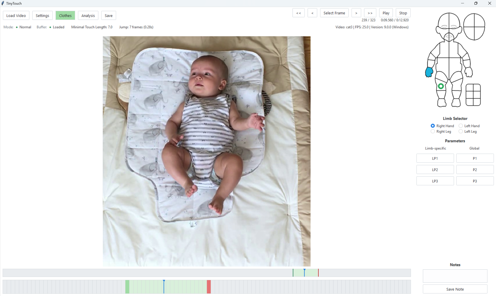
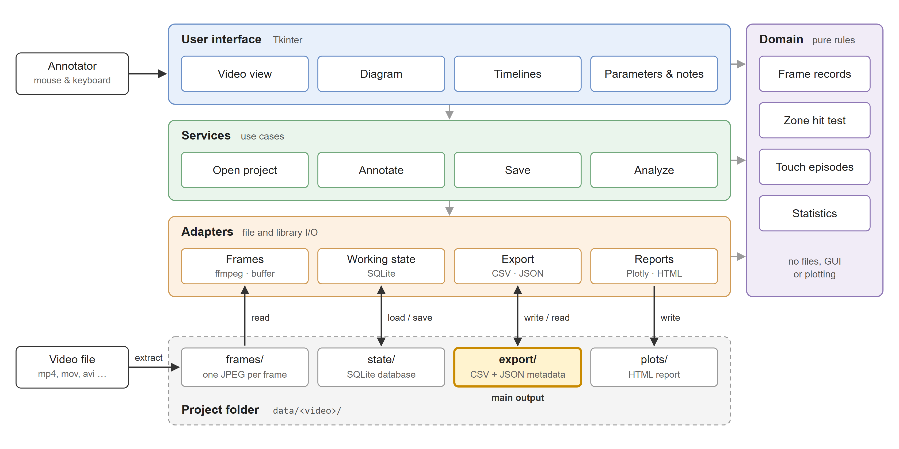

# TinyTouch

A desktop application for labelling events in infant videos. Mark when touches
start and end on a body diagram, and use custom parameter buttons to label other
events and observations.




## New in 9.3.0

- **Video library and guided setup:** resume a labeled video or prepare a new one
  with its diagram, zone labels, channel names, and parameters. Loading an existing
  video offers resume or an independent copy.
- **Shareable coding configurations:** save and load JSON configurations so coders
  can reuse the same settings. Each prepared video keeps its frozen configuration.
- **Clear zone identities:** labels appear while coding; stable zone IDs remain in
  exports. The General diagram has twelve selectable zones, with fixed channel
  associations recorded in metadata.
- **Updated exports:** one CSV row per frame, Channel1–4 columns, paired coordinates
  and per-point zone lists, plus rounded millisecond timestamps. A JSON settings
  snapshot and a labeled diagram image accompany each export.
- **Coding improvements:** resize the diagram, see zone labels on hover, and review
  touches missing an offset before analysis. Playback and timeline redraws are smoother.

**Export compatibility:** the new CSV format differs from older releases. Update
external analysis scripts using the [data format specification](docs/DATA_FORMAT.md).

## New in 9.1.0

- **Dark mode:** choose Light or Dark in Settings; your preference is remembered.
- **General-purpose template:** eight numbered zones and four annotation channels
  for coding schemes beyond anatomical body maps. The four channel boxes are zones
  too, so one channel can be recorded as touching another.
- **GPU-accelerated video rendering:** uses the GPU for video scaling and drawing
  to improve playback performance on supported hardware, with automatic CPU fallback.

## Install

Download TinyTouch from the
[Releases page](https://github.com/Humanoids-CTU/tiny-touch/releases).

**Windows 10/11 (64-bit):** download **windows-x64.zip**, extract it, and
double-click **TinyTouch-v9.3.0.exe** (the version number matches your download).

**Linux (Ubuntu 24.04 or newer, Intel/AMD 64-bit):** download **linux-x64.zip**
and extract it. Open a terminal in the extracted folder and run
(use the version number you downloaded):

```bash
chmod +x TinyTouch-v9.3.0
./TinyTouch-v9.3.0
```

## Label a video

1. Click **Load Video** to open the video library. Resume an existing project or
   choose **Load new video** and select a video file. Review the diagram, zone
   labels, channel names, and parameters, then prepare the video. Preparing it may
   take a few minutes the first time.
2. Use **Special Zones** to mark body areas of interest (e.g. covered by clothing) and
   describe them in its **Note** field.
3. Select the channel you are labeling. Each of the four channels shows its study-specific name.
4. At the **first frame of a touch**, **left-click** its location on the body
   diagram. A green dot marks the start.
5. At the **first frame after the touch ends**, **right-click** its last location.
   A red dot marks the end.
6. Use the global or channel-specific parameter buttons to label additional
   observations as **ON** or **OFF**.
7. Add text notes to individual frames as needed.

| Control | Action |
| --- | --- |
| Left / right arrow | Step one frame; hold for 150 ms to play backward / forward (when Hold arrows is enabled) |
| **<** / **>**, or mouse wheel | Previous / next frame |
| Shift + arrow, or **<<** / **>>** | Jump back / forward |
| Space, or **Play / Stop** | Play or pause |
| Click a timeline | Jump to that point |
| Left-click on the body diagram | Mark touch start (onset, green dot) |
| Right-click on the body diagram | Mark touch end (offset, red dot) |
| Middle-click a dot | Delete a mark |

The boxes beside the body diagram can represent custom actions, such as touching
or picking up an object; agree on what each box means before labeling.

### Share a coding configuration

Put shared setup files such as `coding_look.json` in the `config/` folder beside
the application's `config.json`. Select a configuration while preparing a new
video to prefill its diagram, zone names, four channel names, and all six
parameter labels. Review or edit the values before preparing the video. You can
also save a configuration from the setup wizard and give that JSON file to another
coder. See [config/README.md](config/README.md) for the file format.

Successful preparation freezes a complete copy of the coding setup inside the
video project. Later edits to a shared JSON file never change prepared videos.
Appearance, playback preferences, and annotations remain editable.

## Settings

| Setting | What it does |
| --- | --- |
| Appearance | Chooses Light or Dark. Applies immediately and remembers your choice; body diagrams stay white. |
| Video renderer | Automatic prefers GPU drawing, including integrated graphics, and falls back to CPU. Choose CPU to compare. The active renderer is shown underneath. Changing renderer pauses playback. |
| Video downscale | Makes video images smaller. Try `2` (half size) if the app feels slow. |
| Diagram size | Not in Settings: drag the small grip in the diagram's bottom-left corner to make the body diagram larger or smaller. The proportions stay fixed and the size is remembered. |
| Dot size | Changes the size of the marks on the diagram. |
| Fast-jump seconds | Sets how far **<< / >>** and **Shift + arrow** jump. |
| Hold arrows to play | Steps once on key-down, starts playback after a 150 ms hold, and stops on release. Targets the video's frame rate without skipping frames; slower rendering slows playback. Disable for keyboard-repeat stepping. **< / >** always step one frame. |
| Coding setup | Shows the prepared project's fixed diagram and naming configuration. Set these names in the new-video wizard. |

Newly generated video frames fit within **1920 × 1080**, preserving aspect ratio
and every frame index. Smaller inputs are not enlarged during preparation.
Original video files and existing frame caches are kept unchanged. GPU drawing
works with both new and existing caches.

During playback, video frames retain their source timing while annotation controls
and timelines refresh up to 25 times per second. Pausing, releasing an arrow, or
starting an annotation synchronizes the controls to the displayed frame. Entering
the Notes box pauses playback before editing. Use Automatic/GPU rendering for
high-frame-rate videos; slower machines may still play below source FPS.

## Find your data and run analysis

Your work is stored in `data/`, with a separate folder for each video.
For example, labels for `infant_042.mp4` are saved in:

```text
data/infant_042/export/infant_042_metadata.json
data/infant_042/export/infant_042_diagram.png
data/infant_042/export/infant_042_export.csv
```
The **JSON** records the export format version, frame rate, diagram, coordinate
conventions, and the complete coding setup used by this video.

The **CSV** has one row for each video frame. Its columns contain your labels:
touch starts and ends (onsets and offsets), body areas, notes, and ON/OFF values
for global and channel-specific parameters. `Channel1` through `Channel4` are
stable export identifiers; metadata maps them to the names used in your study.
Each channel's `XY` cell contains JSON coordinate pairs and its `Zones` cell
contains matching zone groups, preserving multiple points and multiple zones
per point. Standard CSV quoting is expected when viewing the raw file. See
[DATA_FORMAT.md](docs/DATA_FORMAT.md) before updating an analysis script.

For a quick overview, click **Analysis** to open a report in your browser with
touch counts, durations and charts.
The report and summary CSV tables are saved in `data/infant_042/plots/`.
Open `master_infant_042.html` to view it again, or share the whole `plots/` folder.


## Reliability between two coders

For a second coder's pass, load the same video and choose **Reliability**.
The new pass inherits the original's complete coding setup.
TinyTouch adds `_reliability` to the project and output names, keeping the two
coders' labels separate. Compare the two exports in your own analysis to measure
agreement between coders. TinyTouch does not calculate reliability itself.

## Architecture

TinyTouch separates its user interface, application services, file and library
adapters, and annotation rules. Each video has its own project folder containing
extracted frames, saved annotations, exports, and analysis reports.

[](docs/paper/figures/sw_architecture.png)

Grey arrows show code dependencies; dark arrows show data flow. Click the diagram
to view it at full size. See [ARCHITECTURE.md](ARCHITECTURE.md) for implementation
details.

## License and contact

Copyright (c) 2026 Czech Technical University in Prague.
Licensed under [GNU GPL version 3 only](LICENSE).

Contact: **Lukáš Navara** — [lukas.navara@cvut.cz](mailto:lukas.navara@cvut.cz).
