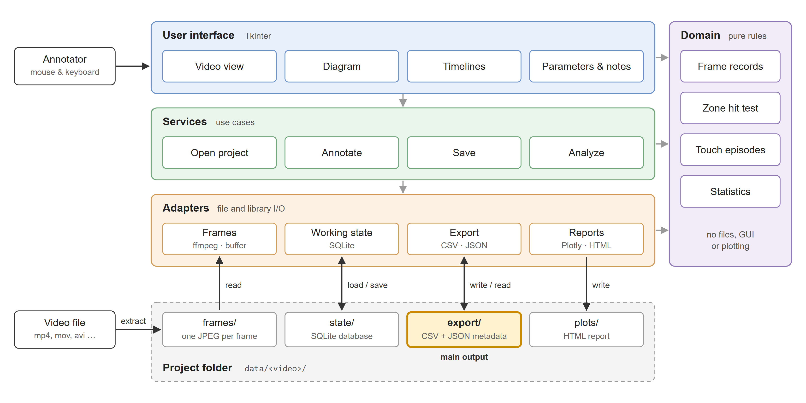

## 2.2 Software architecture

TinyTouch is a desktop application written in Python 3.12 with a Tkinter graphical interface, using open-source components including: ffmpeg (with OpenCV as a fallback) for frame extraction, Pillow for image decoding, SQLite for storing work in progress, pandas for tabular output, and Plotly for analysis reports. It is distributed as standalone executables for Windows and Linux that require no Python installation, and it runs fully offline, so video recordings of participants never leave the researcher's computer. The code is organized in four layers (Fig. X). The domain layer contains the annotation rules (the per-frame data model, the assignment of each click to a zone on the selected template, and the reconstruction of touch episodes and their statistics) and has no file, interface, or plotting code. Adapters handle all input and output, services orchestrate the use cases (opening a project, annotating, saving, analyzing), and the graphical interface sits on top. Dependencies point in one direction only, towards the domain layer, which is independent of the other application layers; this keeps the rules testable and their results reproducible independently of the interface.

Each video becomes a self-contained project folder. When a video is first opened, all its frames are extracted once to image files; during coding, a background buffer decodes the frames around the current position, supporting frame-by-frame stepping and continuous playback without an external media player (Section 2.3.4). Annotations are kept in memory and saved to a per-video SQLite database, from which work is resumed; each database save is a single transaction, protecting the stored annotations from partially completed database writes. Every save also writes the export: a CSV file with one row per video frame and a JSON file recording the frame rate, annotation template, parameter labels, and labeling time (Section 2.3.6). The export format is documented, and the built-in analysis (Section 2.3.7) reads only these files, so its results can be reproduced from the exported data alone. Automated tests, including tests that check the export format byte for byte, protect this behavior as the software evolves.

**Fig. X.** Software architecture of TinyTouch. Coloured bands are the code layers; grey arrows show dependencies, which point only towards the domain layer of pure annotation rules. Dark arrows show the data flow between the application and the project folder created for each video.
